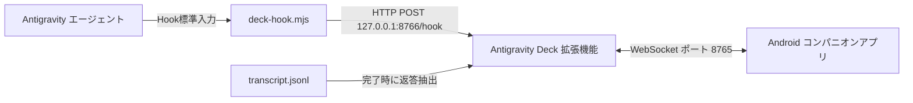

[English](./README.md) | 日本語

# Antigravity Deck

Google Antigravity 上で動いているエージェントを、手元の Android スマートフォンから監視と操作するためのコンパニオンシステムです。

PC 側で動く VS Code 互換拡張機能と Android アプリを WebSocket で直結しており、離席中でもエージェントへの指示出し、返答の確認、コマンド実行の承認をスマホだけで完結できます。

## 主な機能

* エージェントの状態同期: `idle` / `thinking` / `waiting_approval` / `done` / `error` の各状態をリアルタイムでスマホ画面へ反映し、ステータスに応じた配色と振動で通知します
* 会話履歴とセッション切り替えおよびアーティファクト閲覧: 過去の会話セッション一覧から任意のスレッドへ切り替えられ、会話履歴の振り返りや `implementation_plan.md` / `task.md` / `walkthrough.md` などの成果物タブ表示、承認待ち時のコンテキスト切り替え、テキストや Push-to-Talk 音声入力からの指示出しを行えます
* 承認プレビューと通知バー操作: `PreToolUse` フックで捕捉した実行予定コマンドやファイル変更の要約を確認し、アプリ画面だけでなく通知バー上の Approve と Reject ボタンから直接応答できます
* 自動承認モードと Antigravity Turbo 連動: スマホ側の自動承認モードをオンにすると承認画面や通知を出さずに自動許可でき、PC 側の Antigravity IDE が Turbo モードになっている場合も自動で読み取って承認待ちをスキップします
* 通知とアプリ言語の設定: 承認待ち通知、承認通知へのプレビュー表示、会話終了通知、エラー通知、バイブレーションに加えて、アプリ内の表示言語を System / 日本語 / English から切り替えられます
* モデルと推論レベルの切り替え: `Gemini 4 Hydrogen` / `Gemini 4 Argon` / `Gemini 3.8 Flash` / `Claude Sonnet 5.5` / `Claude Opus 5.5` / `GPT-OSS 120B` / `Orchestrator (Argon)` の選択と、`low` / `medium` / `high` / `xhigh` の切り替えに対応しています
* バックグラウンド常駐: フォアグラウンドサービスとして接続を維持するため、画面を閉じていても状態通知や承認待ちの受け取りが可能です
* 自動アップデート: PC 拡張機能は Visual Studio Marketplace / Open VSX Registry / GitHub Releases、Android アプリは GitHub Releases からのアプリ内アップデートに対応しています

## 導入と使い方

### インストール

* PC 拡張機能: Antigravity IDE の拡張機能ビューで `Altairu.antigravity-deck` (`Antigravity Deck`) を検索してインストールするか、[GitHub Releases](https://github.com/Altairu/Antigravity-Deck/releases) から `.vsix` ファイルを取得して導入します
* Android アプリ: [GitHub Releases](https://github.com/Altairu/Antigravity-Deck/releases) から最新の `antigravity-deck-*.apk` をダウンロードして端末へインストールします

### PC とスマホの接続

* Wi-Fi 接続を使う場合: 同じネットワーク内で PC 側のコマンドパレットから `Antigravity Deck: Show Pairing QR` を実行し、Android アプリ右上の `QR` ボタンから QR コードを読み取ります
* USB 有線接続を使う場合: スマホを USB デバッグ接続した状態で PC 側からポートフォワーディングを実行し、アプリ右上の `USB` ボタンをタップします

```powershell
adb reverse tcp:8765 tcp:8765
```

### 日常の操作

* 下部の入力欄またはマイクボタンの長押しで Antigravity へメッセージを送信できます
* 承認待ち状態になると画面と通知にコマンド内容が表示されるため、`Approve` または `Reject` を押して進行を制御します
* 画面右上の通知アイコンから、イベントごとの通知有無、表示言語、アプリのアップデート確認を行えます

## システム構成



## リポジトリ構成

* `protocol/` : PC と Android 間で共有する WebSocket JSON スキーマ定義と仕様ドキュメント
* `extension/` : TypeScript 製の VS Code 互換拡張機能本体
* `android/` : Kotlin と Jetpack Compose で構築された Android コンパニオンアプリ
* `.agents/` : Antigravity の Lifecycle Hooks 設定と通知用スクリプト
* `.github/workflows/` : タグプッシュ時に `.vsix` と `.apk` をビルドしてリリース公開する GitHub Actions 定義

## 開発者向けビルド手順

### PC側拡張機能

```powershell
cd extension
npm install
npm run compile
node ./test/integration-test.mjs
npm run package
```

IDE を起動せずに動作確認だけを行う場合は、スタンドアロンブリッジを利用できます。

```powershell
node extension/scripts/standalone-bridge.mjs --simulate
```

### Android アプリ

```powershell
cd android
$env:JAVA_HOME = "C:\Program Files\Android\Android Studio\jbr"
$env:ANDROID_HOME = "$env:LOCALAPPDATA\Android\Sdk"
.\gradlew.bat testDebugUnitTest assembleDebug --no-daemon
```

## Lifecycle Hooks 連携

コマンドパレットから `Antigravity Deck: Setup Workspace Hooks` を実行するか、ペアリング画面の導入ボタンを押すと、任意のワークスペースへ `.agents/scripts/deck-hook.mjs` の生成と `.agents/hooks.json` へのマージを自動で行えます。設定の `antigravityDeck.autoSetupWorkspaceHooks` を有効にすれば、ワークスペース起動時の自動導入にも対応します。

`.agents/hooks.json` では `SessionStart` / `PreInvocation` / `PreToolUse` / `PostToolUse` / `Stop` の各イベントを `.agents/scripts/deck-hook.mjs` へ転送しています。スマホからの承認待ち中にタイムアウトしないよう、`PreToolUse` の `timeout` は `300000` ミリ秒、スクリプト側の待機は `295000` ミリ秒、拡張機能側の保留待機は `290000` ミリ秒に設定しています。

## ライセンス

MIT License のもとで公開しています。詳細は [LICENSE](./LICENSE) を参照してください。
