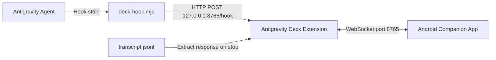

English | [日本語](./README.ja.md)

# Antigravity Deck

A companion system for monitoring and controlling Google Antigravity agents directly from your Android phone.

It connects a VS Code-compatible extension on your PC to an Android app over WebSocket, allowing you to send prompts, read responses, and approve or reject tool executions even while away from your desk.

## Key Features

* Real-time Agent Sync: Mirrors `idle`, `thinking`, `waiting_approval`, `done`, and `error` states to your phone with status colors and haptic feedback
* Prompt Input & Markdown Responses: Send messages via text or Push-to-Talk voice input and read Antigravity replies rendered as Markdown with headings and code blocks
* Approval Previews & Notification Actions: Inspect pending commands or file changes captured via `PreToolUse` hooks and respond directly from the app or Approve/Reject notification buttons
* Notification & Language Settings: Toggle notifications and vibration per event (approval requests, preview details, task completion, errors) and switch app language between System, Japanese, and English
* Model & Reasoning Effort Control: Switch between `Gemini 4 Hydrogen`, `Gemini 4 Argon`, `Gemini 3.8 Flash`, `Claude Sonnet 5.5`, `Claude Opus 5.5`, `GPT-OSS 120B`, and `Orchestrator (Argon)`, as well as `low`, `medium`, `high`, and `xhigh` reasoning effort
* Background Connection: Runs as a foreground service so you still receive status updates and approval prompts with the screen off
* Built-in Updates: Supports updates via Open VSX Registry / GitHub Releases for the PC extension and in-app updates from GitHub Releases for the Android app

## Getting Started

### Installation

* PC Extension: Search for `Altairu.antigravity-deck` (`Antigravity Deck`) in the Antigravity IDE Extensions view, or install a `.vsix` package from [GitHub Releases](https://github.com/Altairu/Antigravity-Deck/releases)
* Android App: Download the latest `antigravity-deck-*.apk` from [GitHub Releases](https://github.com/Altairu/Antigravity-Deck/releases) and install it on your device

### Pairing PC and Phone

* Over Wi-Fi: Run `Antigravity Deck: Show Pairing QR` from the Command Palette on your PC, then tap the `QR` button in the Android app to scan the code
* Over USB: Enable USB debugging on your phone, run port forwarding on your PC, and tap the `USB` button in the Android app

```powershell
adb reverse tcp:8765 tcp:8765
```

### Daily Usage

* Type in the bottom input bar or hold the microphone button to send a prompt to Antigravity
* When approval is required, review the command details in the app or notification and tap `Approve` or `Reject`
* Open the settings icon in the top-right corner to configure per-event notifications, switch language, or check for app updates

## Architecture



## Repository Structure

* `protocol/` : Shared WebSocket JSON schemas and protocol specifications
* `extension/` : VS Code-compatible extension written in TypeScript
* `android/` : Android companion app built with Kotlin and Jetpack Compose
* `.agents/` : Antigravity Lifecycle Hooks configuration and relay scripts
* `.github/workflows/` : GitHub Actions workflows for building and publishing `.vsix` and `.apk` releases on tags

## Building from Source

### PC Extension

```powershell
cd extension
npm install
npm run compile
node ./test/integration-test.mjs
npm run package
```

To test the protocol without launching the IDE, run the standalone bridge:

```powershell
node extension/scripts/standalone-bridge.mjs --simulate
```

### Android App

```powershell
cd android
$env:JAVA_HOME = "C:\Program Files\Android\Android Studio\jbr"
$env:ANDROID_HOME = "$env:LOCALAPPDATA\Android\Sdk"
.\gradlew.bat testDebugUnitTest assembleDebug --no-daemon
```

## Lifecycle Hooks Integration

`.agents/hooks.json` forwards `SessionStart`, `PreInvocation`, `PreToolUse`, `PostToolUse`, and `Stop` events to `.agents/scripts/deck-hook.mjs`. To prevent premature timeouts while waiting for mobile approval, `PreToolUse` uses a `300000` ms hook timeout, `295000` ms script wait, and `290000` ms extension hold timeout.

## License

Released under the MIT License. See [LICENSE](./LICENSE) for details.
