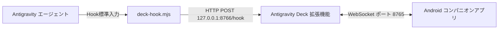

# Antigravity Deck

Google Antigravity 上で稼働する単一エージェントの状態をリアルタイムで監視し、手元の Android スマートフォンから承認操作や音声プロンプト送信、モデルおよび推論レベルの切り替えを行うコンパニオンシステムです。

## 主な機能

* 単一エージェントの状態監視カード: エージェントの実行状態である `idle` / `thinking` / `waiting_approval` / `done` / `error` に応じて配色と枠線のパルス演出が変化し、タスク名と利用中の AI モデルおよび推論レベルを表示します
* 承認プレビューとリモート操作: `PreToolUse` フックで捕捉した実行予定コマンドや変更ファイルの要約を等幅フォントで表示し、アプリ画面および Android 通知バー上の `Approve` ボタンと `Reject` ボタンから承認や拒否を返します
* 音声入力とテキスト送信: Push-to-Talk マイクボタンを長押しして話した内容を音声認識で送信できるほか、キーボードアイコンからテキスト入力欄を展開してプロンプトを送信できます
* AI モデルと推論レベルの切り替え: `Gemini 4 Hydrogen` / `Gemini 4 Argon` / `Gemini 3.8 Flash` / `Claude Sonnet 5.5` / `Claude Opus 5.5` / `GPT-OSS 120B` / `Orchestrator (Argon)` のモデル選択と、`low` / `medium` / `high` / `xhigh` の推論レベル切り替えに対応しています
* ハプティクス振動と通知連携: `waiting_approval` に遷移したときは短い 2 回振動と高優先度通知、`done` では長い 1 回振動と完了通知、`error` では連続振動とエラー通知を発火します
* バックグラウンド常駐監視: フォアグラウンドサービスとして動作を継続し、アプリを閉じた状態や画面消灯時でも WebSocket 接続を維持して通知からの承認と拒否を行えます

## リポジトリ構成

* `protocol/` : PC と Android の間で共有する単一エージェント向け WebSocket JSON スキーマ定義とサンプルペイロード
* `extension/` : VS Code 互換 IDE および Antigravity 上で動作し、WebSocket サーバーとローカル Hook 受信サーバーを提供する TypeScript 製拡張機能
* `android/` : Kotlin と Jetpack Compose および Material 3 で構築された Android コンパニオンアプリ
* `.agents/` : Antigravity の Lifecycle Hooks からローカルサーバーへ状態と承認待機を通知する設定とスクリプト

## システム構成図



## セットアップとビルド手順

### PC側拡張機能のビルドとパッケージ化

```powershell
cd extension
npm install
npm run compile
node ./test/integration-test.mjs
npm run package
```

生成された `extension/antigravity-deck-0.1.0.vsix` を Antigravity または VS Code の拡張機能ビューからインストールしたあと、ウィンドウをリロードしてください。

IDE 本体を介さず単体で動作確認する場合は、スタンドアロンブリッジを起動します。環境変数 `DECK_WS_PORT` / `DECK_HOOK_PORT` / `DECK_AUTH_TOKEN` を指定すると待機ポートと認証トークンを変更できます。

```powershell
node extension/scripts/standalone-bridge.mjs --simulate
```

### Androidアプリのビルドと実機インストール

Java と Android SDK の環境変数を設定したうえでユニットテストとデバッグ APK のビルドを実行し、接続済みの実機へインストールします。

```powershell
cd android
$env:JAVA_HOME = "C:\Program Files\Android\Android Studio\jbr"
$env:ANDROID_HOME = "$env:LOCALAPPDATA\Android\Sdk"
.\gradlew.bat testDebugUnitTest assembleDebug --no-daemon
& "$env:ANDROID_HOME\platform-tools\adb.exe" install -r app\build\outputs\apk\debug\app-debug.apk
```

## 接続方法

### USB有線接続によるワンタップ接続

スマートフォンを USB デバッグ接続した状態でポートフォワーディングを設定します。アプリを起動すると自動で `127.0.0.1:8765` へ接続を試行し、上部バーの `USB` チップからもワンタップで再接続できます。

```powershell
adb reverse tcp:8765 tcp:8765
```

### LAN内Wi-Fi接続とQRペアリング

同じ LAN 内のスマートフォンから接続する場合は、PC 側のコマンドパレットから `Antigravity Deck: Show Pairing QR` を実行して接続用 QR コードを表示し、アプリ上部バーの `QR` チップから読み取ってください。

## Lifecycle Hooks 連携

`.agents/hooks.json` では `SessionStart` / `PreInvocation` / `PreToolUse` / `PostToolUse` / `Stop` の各イベントを `.agents/scripts/deck-hook.mjs` へ転送しています。スマホからの応答待ち中にタイムアウトしないよう、`PreToolUse` には `300000` の `timeout` を設定し、スクリプト側の HTTP 待機は `295000` ミリ秒、拡張機能側の保留待機は `290000` ミリ秒に設定しています。接続先のホストやポートを変更する場合は環境変数 `ANTIGRAVITY_DECK_HOOK_HOST` と `ANTIGRAVITY_DECK_HOOK_PORT` を指定してください。

## ライセンス

このプロジェクトは MIT License のもとで公開されています。詳細は [LICENSE](./LICENSE) を参照してください。
