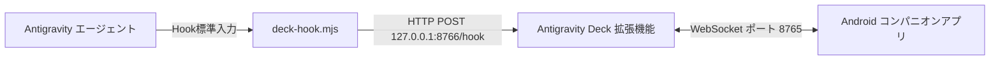

# Antigravity Deck

Google Antigravity上のエージェント状態をPCとAndroidスマートフォン間でリアルタイムに同期し、承認操作や音声プロンプト送信およびモデル切り替えを行うためのコンパニオンシステムです。

## リポジトリ構成

* `protocol/` : PCとAndroidで共有するWebSocketメッセージのJSON Schemaとサンプルペイロード
* `extension/` : VS Code互換IDEおよびAntigravity上で動作する拡張機能
* `android/` : Jetpack Composeで構築されたAndroidコンパニオンアプリ
* `.agents/` : AntigravityのLifecycle Hooksから拡張機能へ通知を送る設定とスクリプト

## システム構成図



## クイックスタート

### PC側拡張機能のビルドとパッケージ化

```bash
cd extension
npm install
npm run compile
npm run package
```

デバッグ実行する場合はVS CodeまたはAntigravityで `extension/` を開いて拡張機能デバッグを開始するか、スタンドアロンブリッジを利用します。

```bash
node extension/scripts/standalone-bridge.mjs --simulate
```

### AndroidアプリのビルドとUSB有線接続

Android実機をUSBデバッグ接続した状態で `adb reverse` を実行し、ローカルの8765番ポートをPCへ転送します。

```bash
adb reverse tcp:8765 tcp:8765
```

アプリを起動すると `127.0.0.1:8765` への接続を自動試行します。Wi-Fi経由で接続する場合は、PC側でコマンド `Antigravity Deck: Show Pairing QR` を実行し、Android側のQRボタンからコードを読み取ります。
