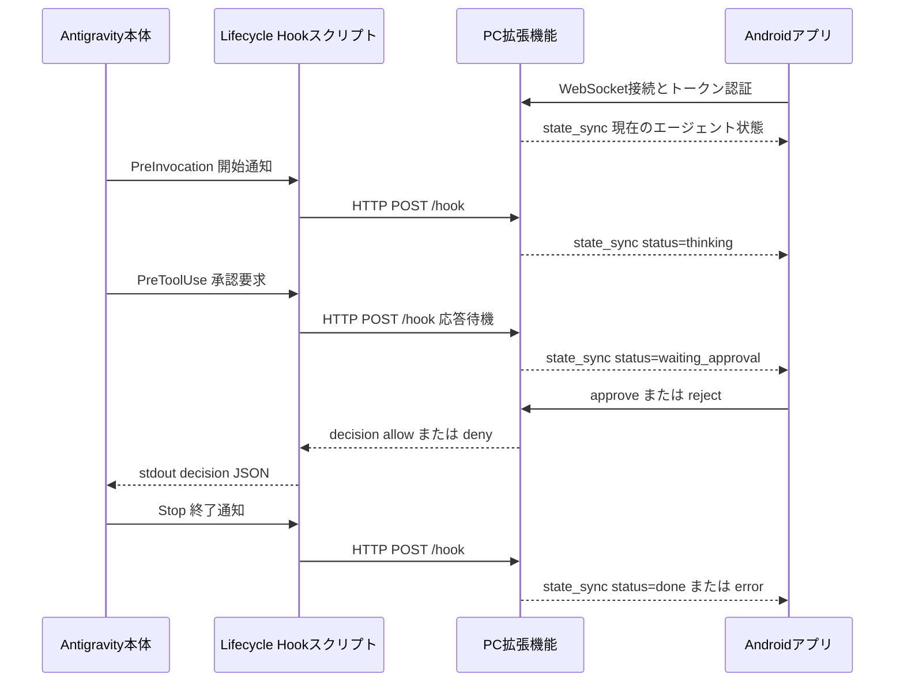

# Antigravity Deck 通信プロトコル仕様

Antigravity DeckはPC上のAntigravity拡張機能とAndroidコンパニオンアプリをWebSocketで直結し、実行中の単一エージェントを監視および操作するための軽量プロトコルです。

## 接続方式とポート構成

* WebSocketサーバーポート: `8765`
* ローカルHook受信HTTPポート: `8766`
* デフォルト認証トークン: `antigravity-local`

### LAN内WebSocket接続

PC側で `Antigravity Deck: Show Pairing QR` を実行すると、以下のような接続情報を含むQRコードが生成されます。

```json
{
  "host": "192.168.1.25",
  "port": 8765,
  "token": "antigravity-local",
  "wsUrl": "ws://192.168.1.25:8765?token=antigravity-local"
}
```

AndroidアプリはQRコードをスキャンすることで、このWebSocket URLへ自動接続します。

### USB有線接続によるワンタップ接続

Wi-Fi環境やファイアウォールの制約を受けずに実機テストを行う場合は、USBデバッグ接続した状態で `adb reverse` を実行します。

```bash
adb reverse tcp:8765 tcp:8765
```

このトンネル設定により、Androidアプリ側のワンタッププリセットから `ws://127.0.0.1:8765?token=antigravity-local` へ直接接続できます。

## 認証方式

WebSocketハンドシェイク時、以下のいずれかの方法でトークンを検証します。

* 接続URLのクエリパラメータ `?token=<token>`
* HTTPヘッダー `Authorization: Bearer <token>`
* 接続直後に送信する `{"type": "auth", "token": "<token>"}` メッセージ

トークンが一致しない接続はステータスコード `4001` で切断されます。

## 状態同期と操作のシーケンス



## メッセージ仕様

### PCからAndroidへの状態同期

スキーマ定義は [server-to-client.schema.json](./schema/server-to-client.schema.json) にあります。メッセージ種別は `state_sync` です。

* `title`: タスクや会話の見出し文字列
* `status`: `idle` / `thinking` / `waiting_approval` / `done` / `error` のいずれか
* `approval_preview`: 実行予定のコマンドや変更ファイル差分の要約文字列、または `null`
* `last_response`: エージェントの最新返答テキスト、または `null`
* `reasoning_effort`: `low` / `medium` / `high` / `xhigh` のいずれか
* `model_name`: セッションで現在利用中のAIモデル識別子文字列
* `available_models`: 選択可能なAIモデル一覧配列

### AndroidからPCへの操作コマンド

スキーマ定義は [client-to-server.schema.json](./schema/client-to-server.schema.json) にあります。コマンド種別は `type` フィールドで指定し、互換性のために `action` フィールドも受理します。

* `approve`: 承認待ちのツール実行またはファイル変更を許可する
* `reject`: 承認待ちのツール実行またはファイル変更を拒否する
* `send_prompt`: 音声入力やテキストから取得した `prompt` をエージェントへ送信する
* `set_reasoning_effort`: `reasoning_effort` を変更する
* `set_model`: `model_name` を指定したAIモデルへ切り替える
